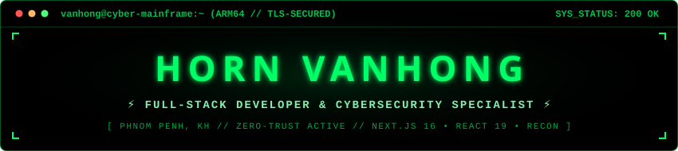
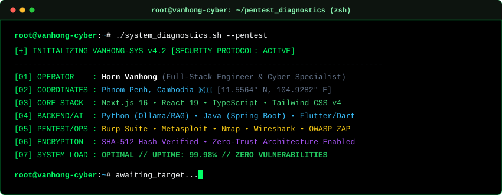

<!-- ═══════════════════ DEEP BLACK CYBER TERMINAL BANNER ═══════════════════ -->

 

<!-- ═══════════════════ ANIMATED MATRIX TERMINAL ═══════════════════ -->

 

<!-- ═══════════════════ MATRIX ACCESS BADGES ═══════════════════ -->

  
  
  
  

---

<!-- ═══════════════════ REAL CYBER TERMINAL WINDOW ═══════════════════ -->

  

---

### ⚡ Technical Arsenal & Tooling

#### 🛡️ Penetration Testing & Offensive Security Toolkit

  
  
  
  
  
  
  
  

#### 🌐 Frontend Architecture

  

#### ⚙️ Backend, Mobile & Languages

  

#### 🧰 Systems, DevOps & Environments

  

#### 🤖 AI Engineering & LLM Automation

  
  
  
  

---

### 🛰️ Flagship Deployments & Repositories

  
  

 

  
  

 

  
  

---

### 📊 Mainframe Telemetry & Analytics

  
  

 

  

 

<!-- ═══════════════════ DEEP MATRIX FOOTER ═══════════════════ -->

  <code>╔════════════════════════════════════════════════════════════════════════════════════════╗</code> 
  <code>║ SYSTEM INTEGRITY: 100% // ALL THREADS SECURED // ZERO-TRUST ARMED // © 2026 HORN VANHONG ║</code> 
  <code>╚════════════════════════════════════════════════════════════════════════════════════════╝</code>

